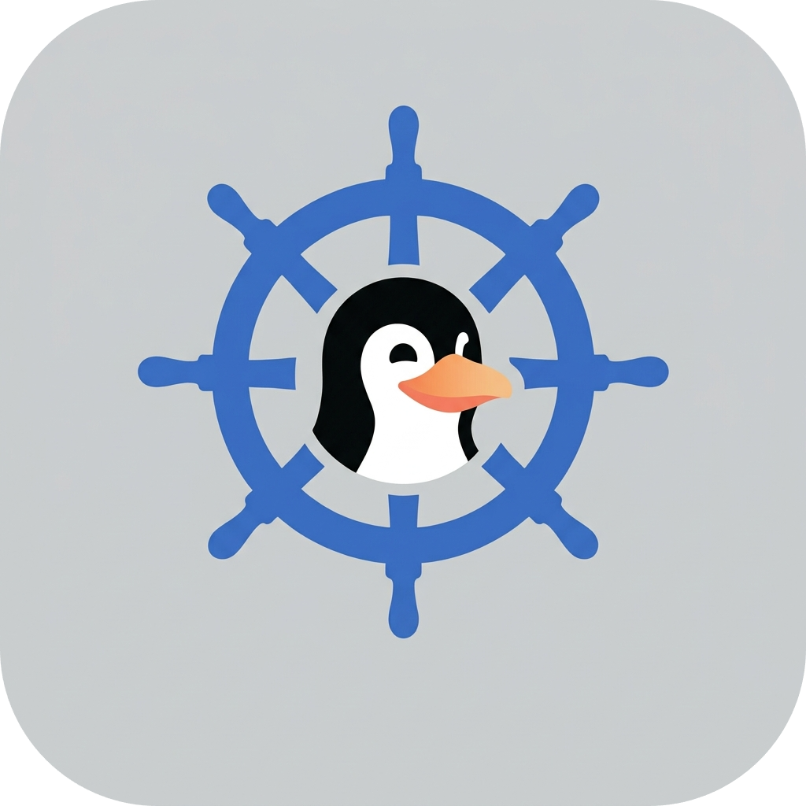

> ### [Documentación en español](README.md)

<div align="center">
  
</div>

# LinuxHelm

**LinuxHelm** is a desktop application for Linux built with **Kotlin** and
**Compose Multiplatform**. It works as a system utilities panel: it shows information
about your machine (package manager, disks and their health status), lets you
**add and run scripts** from a graphical interface, and ships with two system tools:
`ulxCheckDirtyDrives` (fixes NTFS partitions left "dirty" by Windows) and
`ulxFixDiskOwnership` (fixes secondary disks mounted with the `root:root` owner).

- Multilingual: **English**, **Español**, **中文**, **Português** (English by default).
- **Light** and **dark** theme, persisted between sessions.
- Scripts and settings are stored in SQLite (`~/.config/ulx/LinuxHelm/lh.db`), so they
  survive restarts.
- Adjustable **UI scale** (100–200%) for HiDPI screens, applied live and persisted.

---

## Contents

- [Features](#features)
- [Requirements](#requirements)
- [Building and running](#building-and-running)
- [How to use the application](#how-to-use-the-application)
- [Bundled tools](#bundled-tools)
- [Technical section](#technical-section)
- [Project structure](#project-structure)
- [Tests](#tests)

---

## Features

| Screen | What it offers |
|---|---|
| **Home** | Menu with the app logo and access to every screen. |
| **Information** | Detected package manager (with a link to its wiki) and a disk list with size, usage and health status (quick and deep check). |
| **Tools** | Script launcher: add `.sh`, `.jar`, `.py`, `.AppImage`, binaries… and run them in a system terminal. |
| **Settings** | Language, theme (light/dark) and UI scale (100–200%) selectors, saved instantly. |

Useful details:

- **Scripts are never moved or copied**: only the path you picked is stored.
- Running one opens a **real terminal window**: you can answer prompts, type your
  `sudo` password and watch the output live.
- The terminal **stays open after the script finishes** ("Press any key to close") so
  you can read the result, and reports the exit code if it failed.
- The app detects when a script **no longer exists** or **lacks execute permission
  (+x)** and warns you before it fails.
- Bundled tools **cannot be deleted** from the interface.

---

## Requirements

**To use the app** (Linux):

- Any desktop with a terminal emulator installed
  (`gnome-terminal`, `konsole`, `xfce4-terminal`, `kitty`, `xterm`…; `x-terminal-emulator`,
  the Debian/Ubuntu standard, is tried first).
- `lsblk` (from `util-linux`, preinstalled on most distros) for the Information screen.
- Optional, for the **deep** disk check: `pkexec` (policykit) and the matching
  filesystem tools (`e2fsprogs`, `ntfs-3g`, `dosfstools`, `btrfs-progs`).
- For the bundled `ulxCheckDirtyDrives` tool: the **`ntfs-3g`** package
  (`sudo apt install ntfs-3g`).
- Optional, for the native file picker: **`kdialog`** (KDE) or **`zenity`** (GNOME and
  others). With neither installed, the dialog built into the app is used.

**To build from source**:

- JDK 17 or newer (Gradle's toolchain plugin resolves it automatically if missing).
- No need to install Kotlin or Compose: everything comes through Gradle.

---

## Building and running

```bash
# Normal run
./gradlew :desktopApp:run

# Hot reload (reloads on save, ideal for development)
./gradlew :desktopApp:hotRun --auto

# Desktop tests
./gradlew :shared:jvmTest

# Package for the current OS (produces a .deb on Linux)
./gradlew :desktopApp:packageDistributionForCurrentOS
# Package every Linux format at once (see empaquetar.sh)
./empaquetar.sh
```

The `empaquetar.sh` script builds **every** format in one step — uber-jar, `.deb`,
`.rpm`, `.tar.gz` and `.AppImage` —, verifies that each file was actually produced and
leaves them in the `dist/` folder. If an optional system tool is missing (`rpmbuild`,
`appimagetool`), that format is skipped with a warning and the rest still builds.

Configured packaging formats are `.deb` and `.rpm` (`desktopApp/build.gradle.kts`),
plus the custom `packageTarGz` and `packageAppImage` tasks. The package is
self-contained: it ships its own JRE and
the bundled tools travel **inside the JAR** (see [Technical section](#technical-section)).

The package name is **Linux Helm**: Debian and rpm package names cannot contain
uppercase or spaces, so jpackage sanitizes it to `linux-helm` (file
`linux-helm_1.0.0_amd64.deb`, installed under `/opt/linux-helm`, launcher
`/opt/linux-helm/bin/Linux Helm`), while the applications menu does show
**"Linux Helm"**.

---

## How to use the application

### Home screen

On launch you see the menu with three buttons: **Information**, **Tools** and
**Settings**. Every secondary screen has a **Back** button at the top left.

### Information

- At the top is the detected **package manager** (apt, dnf, pacman, zypper or emerge).
  The **Check site** button opens its documentation in your browser.
- Below, the **"Detected storage drives"** expander lists the real partitions of the
  machine (Dolphin-style: EFI, swap, RAID and parent partitions are hidden, only children
  are shown). For each drive you get:
  - Name (the volume label, or "Internal/removable drive of X GiB" if unlabeled).
  - Mount point, total size and used space.
  - A traffic-light status indicator: green (no errors), yellow (warning, e.g. mounted
    read-only), grey (unchecked) or red (errors).
- **Deep check**: runs a **read-only** check with elevated privileges (the `pkexec`
  password dialog will appear). Depending on the filesystem:
  - `ext4/ext3/ext2`: reads the journal state (`dumpe2fs -h`).
  - `ntfs`: `ntfs-3g.probe --readonly` (detects dirty flag and Windows hibernation).
  - `vfat`: `fsck.fat -n` (detects the dirty bit).
  - `btrfs`: `btrfs device stats` (I/O error counters).
- The **quick** check (no root) already runs when the screen opens: it reads the kernel
  error counters in `/sys/fs/...` for ext4/btrfs and detects drives mounted read-only.
  When it cannot verify anything, it reports "Unchecked" (it never claims something is
  fine without having verified it).

### Tools

This is the heart of the app: your script launcher.

1. Click **Add script** and pick the file with the **desktop-native dialog** (KDE's Qt
   dialog via `kdialog`, GNOME's GTK dialog via `zenity`, or the dialog built into the
   app as a last resort). Supported: `.sh`, `.jar`, `.py`, `.AppImage`, `.run`, `.bin`
   and extensionless binaries — the native dialog applies no type filter, so every
   file is visible.
2. In the dialog, type the **Name** (pre-filled with the file name) and, optionally, a
   **Website** (e.g. the project's page).
3. In the list, click **Run**: a terminal window opens with the script running. When it
   finishes, the terminal stays open so you can read the output; if the script failed,
   the exit code is shown.
4. **Check site** (only if you provided a URL) opens the page in the browser.
5. The **trash** removes the script from the list. Note: it deletes the record, **not**
   the file on disk; you can add it again anytime.

How each file type is launched:

| File | How it runs | Needs +x? |
|---|---|---|
| `.sh` | `bash file.sh` | No |
| `.jar` | `java -jar file.jar` | No |
| `.py` | `python3 file.py` | No |
| Others (binaries, `.AppImage`…) | Executed directly | **Yes** |

The app sets the **working directory to the script's own folder**, so scripts using
relative paths work exactly as if you launched them by hand.

If a file disappears from disk or lacks the +x permission, its row shows a red warning
and the **Run** button is disabled.

### Settings

Three controls inside a card:

- **Theme**: Light / Dark. The change is **live** (the UI repaints instantly) and
  persisted.
- **Language**: English / Español / 中文 / Português. Applied instantly to every string
  in the interface, also persisted.
- **Scale**: 100% / 125% / 150% / 175% / 200%. Multiplies the whole UI (and the window
  size) by the chosen factor; useful on HiDPI screens. Also applied live.

All three settings are stored in the database; the next time you open the app they are
already applied (no flash of the default theme/language).

---

## Bundled tools

The Tools tab ships two **built-in** tools with no trash icon (they cannot be deleted):

- **`ulxCheckDirtyDrives`**: checks and repairs NTFS partitions flagged as *dirty* or
  hibernated by Windows (`hiberfil.sys` / fast startup). The script itself asks for
  `sudo`.
  Documentation: [`README_EN.md`](./ulxTools/ulxCheckDirtyDrives/README_EN.md)
  ([Español](./ulxTools/ulxCheckDirtyDrives/README.md)).
- **`ulxFixDiskOwnership`**: detects secondary disks/partitions mounted with the
  `root:root` owner (typical under `/mnt/...`) and, if you confirm, hands them over to
  your user. It runs as your normal user (the script refuses to run as root).
  Documentation: [`README_EN.md`](./ulxTools/ulxFixDiskOwnership/README_EN.md)
  ([Español](./ulxTools/ulxFixDiskOwnership/README.md)).

Both live in `ulxTools/` and are deployed and registered by the app on launch (see
[Technical section](#technical-section)). To ship a new tool, just create its folder
with the executable and a `metadata.json`: instructions in
[`ulxTools/README.md`](./ulxTools/README.md).

---

## Technical section

### Stack

| Component | Version / choice |
|---|---|
| Kotlin | 2.4.20 |
| Compose Multiplatform | 1.12.1 |
| Material 3 | 1.12.0-alpha03 |
| kotlinx-coroutines | 1.11.0 (with `coroutines-swing` on desktop) |
| SQLite | `org.xerial:sqlite-jdbc` 3.47.1.0 (pure JDBC) |
| Architecture | `shared` module (KMP, JVM-only target) + `desktopApp` (JVM) |

Although the project is Kotlin Multiplatform, only the **JVM/Desktop** target exists
today: `shared` holds the common code and `desktopApp` the entry point.

### Project structure

```
LinuxHelm/
├── desktopApp/            # JVM entry point (main.kt) and native packaging
├── shared/
│   └── src/commonMain/kotlin/com/example/linuxhelm/
│       ├── App.kt                     # Root: theme + animated navigation
│       ├── ui/
│       │   ├── compose/
│       │   │   ├── Screen.kt              # Pantalla enum + BotonVolver
│       │   │   ├── ScreenPrincipal.kt     # Home menu
│       │   │   ├── ScreenInfo.kt          # Disks, packages, health checks
│       │   │   ├── ScreenTools.kt         # Script launcher
│       │   │   └── ScreenConfiguracion.kt # Language, theme and scale
│       │   ├── ulxComponentes/        # MenuSelector (generic settings dropdown)
│       │   └── ulxLib/                # Infrastructure (see below)
│       └── composeResources/          # logo, etc.
├── ulxTools/              # System tools (see ulxTools/README.md)
└── gradle/                # Version catalog (libs.versions.toml)
```

### Navigation

The navigation state lives at the root (`App.kt`) as a `mutableStateOf` of the
`Pantalla { Principal, Info, Tools, Configuracion }` enum. `AnimatedContent` transitions
between screens (the new one slides in from the right with a fade, the old one slides
left). The home screen receives `onNavigate`, the secondary ones only `onVolver` (back):
so no secondary screen knows where it returns to, the whole flow is controlled from the
root.

### Persistence: SQLite

All persistent state uses a **single SQLite database** at
`~/.config/ulx/LinuxHelm/lh.db` (XDG config standard), managed by the `ulxDB` object
(pure JDBC, every call is blocking → always from `Dispatchers.IO`).

SQLite was chosen over JSON for **atomic writes** (no half-corrupted file if the app
closes at a bad moment) and for having a single source of truth.

Tables:

```sql
scripts (id, name, description, website, path UNIQUE, deletable)
settings (key PRIMARY KEY, value)
```

- **`scripts`**: user scripts (`deletable = 1`) and bundled tools (`deletable = 0`;
  the UI hides the trash and the `DELETE` itself checks it too, double protection).
  `path` with `UNIQUE` + `ON CONFLICT DO UPDATE` makes "re-adding" the same file serve
  as a way to **edit** name/URL without a separate edit screen.
- **`settings`**: key-value store for preferences (`lang`, `theme`, `escala`). **Stable keys** are
  saved (`"dark"`, `"Español"`…), never translated labels, so switching language never
  breaks interpretation of the stored value.
- There is a manual **column migration** (`PRAGMA table_info` + `ALTER TABLE`) because
  `CREATE TABLE IF NOT EXISTS` does not add columns to existing tables.

### System tools

Each tool lives in `ulxTools/<name>/` with its executable and a mandatory
`metadata.json` (`name`, `description`, `website`). `shared/build.gradle.kts` copies
every folder **into the JAR** as a resource tree under the `ULXTools/` prefix
(`jvmProcessResources`). At runtime, `ulxDB.seedSystemTools()`:

1. Extracts the resource tree to a staging folder
   (`~/.config/ulx/LinuxHelm/.ulx-staging`).
2. Discovers the valid tools (executable + `metadata.json`; the main one is the file
   matching the folder name).
3. Copies **only the executables** to `~/.config/ulx/LinuxHelm/tools/` (flat, `+x`).
4. Registers them in the database with `deletable = 0` and their metadata (upsert,
   idempotent).
5. Prunes tools that no longer exist and cleans up the legacy `ULX Tools/` folder from
   older versions.

It is re-deployed **on every launch**, so updating the app always leaves the tools at
their latest version. Traveling in the classpath, it works the same with `run`, a `.deb`,
an AppImage or a tar.gz, with no need for the `ulxTools/` folder on disk. How to add a
new tool: [`ulxTools/README.md`](./ulxTools/README.md).

### Script execution

`ulxScripts.kt` builds the command according to the extension (`bash` / `java -jar` /
`python3` / direct execution) and launches it in a **system terminal** with
`ProcessBuilder`. Why a terminal instead of a background process? So the user can
interact: prompts, stdin and the `sudo` password (asked by the terminal itself).

- List of known terminals from most to least likely, with two invocation styles: those
  taking the command as a string after `-e` (gnome-terminal, xfce4-terminal…) and those
  taking separate argv (konsole, xterm, kitty…).
- The `PATH` is scanned without spawning subprocesses; if no terminal is found, the UI
  warns.
- The inner command chains: run → capture `$?` → print the exit code on failure →
  `read -n1` to keep the terminal open. The whole line is passed through `shellQuote`
  (single quotes) so paths with spaces or `$` don't break.
- Working directory = the file's folder.

### File picker (native dialog)

`pickScriptFile()` (`ulxScripts.kt`) tries, in order:

1. **`kdialog --getopenfilename`** (KDE): the native Qt dialog, the same look as
   Dolphin.
2. **`zenity --file-selection`** (GNOME and others): the native GTK dialog.
3. **`JFileChooser`** with the GTK look and a screen-relative size (last resort).

kdialog and zenity are separate processes: the answer comes back through their
**stdout** (the chosen path) and **exit code** (0 = accepted, 1 = cancelled), with no
D-Bus and no signals. Cancelling never opens the next dialog.

> Why not the XDG Desktop Portal (`gdbus` + `dbus-monitor`): verified on the real bus
> that the `Request.Response` signal is delivered in *unicast* to the `gdbus` process
> that made the call — which dies right after returning the object path — so no
> external listener can ever receive it and the app would wait forever. With CLI tools,
> that route is unworkable.

### UI scale (HiDPI)

The scale (100–200%) is stored in `settings` (`escala`) as a percentage; the UI turns
it into a factor (`"150%"` → 1.5). `main.kt` creates the fixed 1150×760 dp window
**multiplied by the scale**, and `App.kt` provides `LocalDensity` with
`Density(density * escala, fontScale)`. In Compose, sp→px is computed as
`sp × fontScale × density`, so a uniform factor on `density` scales the whole UI with
no double scaling. It is observable, so the change is live.

### Theme and colors

- `ulxColor`: **all** app colors as variables backed by `mutableStateOf`, making them
  observable in composition: switching theme repaints the UI by itself, without
  restarting the window. Screens never create a `Color(...)` by hand.
- `ulxColorManager`: the **single source of truth** for each palette's values
  (light/dark) and translator to a Material 3 `ColorScheme`, so buttons, fields and
  dialogs use the app palette instead of M3's default purple.
- Semantic colors (`exito`/success, `aviso`/warning, `error`, `desconocido`/unknown)
  drive the disk health traffic lights.

### Internationalization

`ulxLang` holds every string as variables defaulting to English; `ulxLangManager`
reassigns them with `setSpanish()`, `setChinese()`, `setPortuguese()`… The **storage
keys** are the fixed selector literals (`"English"`, `"Español"`,
`"中文 (zhōngwén)"`, `"Português"`), which are never translated.

### Startup settings (no flicker)

`main.kt` calls `ulxSettings.loadAndApply()` **before** creating the window: the
database is read once at startup and cached in memory (no SQLite queries inside
compositions). When settings change on the Settings screen,
`saveLang`/`saveTheme`/`saveEscala` update the cache + apply + persist on IO.

### System information

- `getDiskInfo()` runs `lsblk -b -P` and parses the output (including lsblk's `\x20`
  escapes), filters partition tables (EFI by GUID, swap, RAID, LVM, `/boot`…), and
  computes real usage with `File.totalSpace`/`usableSpace` when the drive is mounted.
- `quickCheck` (no root): kernel error counters via
  `/sys/fs/ext4/<dev>/errors_count` and `/sys/fs/btrfs/<uuid>/devinfo/*/error_stats`,
  plus read-only mount detection (`/proc/self/mounts`).
- `deepCheck` (with `pkexec`, read-only): a filesystem-dependent command, interpreting
  both exit codes and output text (e.g. `ntfs-3g.probe` codes 3/4/5 = damaged /
  hibernated / dirty).

---

## Tests

```bash
./gradlew :shared:jvmTest
```

Tests live in `shared/src/commonTest` and `shared/src/jvmTest`: `SharedCommonTest`,
`SharedLogicDesktopTest` and `UlxSystemToolsTest` (system-tool metadata and
deployment). 12 tests in total.
